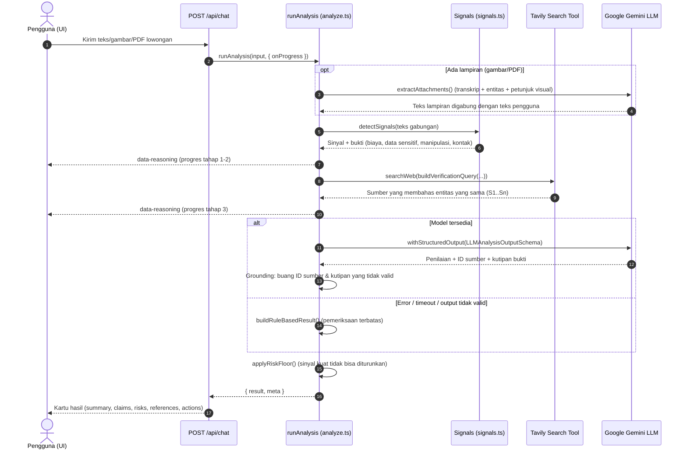

# 🔄 02. AI Processing Workflow & Pipeline

Dokumen ini menjelaskan alur kerja sekuensial (end-to-end processing pipeline) saat pengguna mengirimkan materi lowongan kerja ke TelaahKarier.

---

## 🔁 1. Alur Eksekusi Utama (Primary Flow)

---

## 📋 2. Rincian Tahapan Pipeline

### Tahap 0: Routing (`turn-router.ts`)
1. Pesan dengan gambar atau teks panjang langsung masuk ke analisis.
2. Pesan teks pendek diklasifikasikan model: materi lowongan baru → analisis; pertanyaan → **mode tanya-jawab** (`follow-up.ts`).
3. Mode tanya-jawab memakai lowongan terakhir yang punya verdict sebagai konteks (`conversation-context.ts`). Dengan begitu, pertanyaan seperti "Kenapa ini berisiko?" atau "Saya sudah terlanjur transfer, harus bagaimana?" dijawab tentang lowongan tersebut, bukan dianalisis sebagai lowongan baru.

### Tahap 1: Preprocessing (`preprocessor.ts`)
1. Membersihkan teks, mengekstrak URL dan domain.
2. Memutuskan apakah input berisi materi lowongan (`hasSubstantiveContent`). Jika tidak dan tanpa lampiran, sistem langsung meminta detail lowongan.

### Tahap 1b: Baca Lampiran Dulu (`extraction.ts`)
1. **Batas**: maksimal 4 lampiran, 7 MB per lampiran. Format yang didukung: gambar dan PDF; format lain dijawab "belum didukung".
2. **Ekstraksi** (model `GEMINI_EXTRACTION_MODEL`, suhu 0): untuk setiap lampiran, model mengeluarkan jenis lampiran (poster, screenshot chat, surat/dokumen, postingan medsos, bukan lowongan), keterbacaan, dan transkrip apa adanya. Screenshot chat ditulis per pesan dengan label pengirim, dan bagian yang buram ditandai `[tidak terbaca]`. Model juga mengeluarkan entitas (nama perusahaan, gaji, lokasi, nomor, email, URL) dan maksimal 3 petunjuk visual yang relevan dengan keaslian.
3. **Keputusan setelah membaca**:
   - tidak terbaca atau bukan lowongan (tanpa teks pengguna) → berhenti tanpa verdict, tanpa panggilan analisis;
   - terbaca → transkrip digabung dengan teks pengguna dan dipakai oleh aturan, pencarian web, dan verifikasi kutipan;
   - terbaca sebagian → lampiran asli ikut dikirim lagi ke tahap analisis;
   - gagal (error) → lampiran langsung dikirim ke analisis seperti tanpa tahap ini.
4. Transkrip disimpan di `data-analysis.material`. Aksi dan tanya-jawab memakai transkrip ini, sehingga lampiran **hanya dikirim sekali** ke model.

### Tahap 2: Deteksi Pola Berbasis Aturan (`signals.ts`)
1. **Sinyal kuat** (memberi *risk floor*):
   - permintaan biaya kepada pelamar → minimal *Tinggi*,
   - permintaan data sensitif (OTP, PIN, selfie dengan KTP) → minimal *Tinggi*,
   - upaya manipulasi analisis (prompt injection) → minimal *Sedang*.
2. **Sinyal sedang**: kontak lewat chat pribadi, email domain gratis, shortlink.
3. Pola memahami negasi dan daftar. Contoh: "tidak dipungut biaya pendaftaran maupun biaya pelatihan" dan "biaya pelatihan ditanggung" tidak terdeteksi sebagai permintaan biaya.
4. Sinyal dikirim ke model sebagai `<temuan_otomatis>` untuk dikonfirmasi atau ditolak.

### Tahap 3: Verifikasi Web (`tools/tavily-search.ts`)
1. Query dibangun dari entitas yang bisa diverifikasi: nama badan usaha (PT/CV) atau domain perusahaan. Tanpa entitas, pencarian dilewati karena hanya akan menghasilkan halaman umum.
2. Hasil disaring: hanya sumber yang judul/URL-nya membahas entitas yang sama yang dipakai. Nama harus cocok utuh, misalnya "PT Sukses Makmur Sentosa" ≠ "PT Jaya Sukses Makmur Sentosa Tbk".
3. Sumber yang lolos diberi ID `S1..Sn`. Hanya ID ini yang boleh dikutip model.

### Tahap 4: Pemanggilan LLM & Structured Output (`analyze.ts`)
1. `getLLMModel()` membuat instance `ChatGoogleGenerativeAI` (retry 2x, timeout 45 detik).
2. `.withStructuredOutput(LLMAnalysisOutputSchema, { includeRaw: true })` dipakai untuk mendapatkan output terstruktur sekaligus metadata token.
3. Materi, temuan, dan sumber dibungkus tag data (`<materi_lowongan>`, `<temuan_otomatis>`, `<sumber_pencarian>`). Instruksi di dalamnya diperlakukan sebagai data, bukan perintah.
4. Pasca-proses:
   - verdict dibuang jika `informationSufficient = false`,
   - ID sumber yang tidak ada dibuang,
   - kutipan bukti yang tidak ada di teks lowongan dibuang,
   - keyakinan dibatasi maksimal 0.95.

### Tahap 5: Pengaman & Fallback
1. **Risk floor**: jika sinyal kuat terdeteksi tetapi model menilai lebih rendah (misalnya karena prompt injection), verdict dinaikkan dan alasannya dicatat di tahapan analisis.
2. **Fallback**: jika model gagal, `buildRuleBasedResult()` mengembalikan *pemeriksaan otomatis terbatas* yang diberi label jelas. Hasilnya tidak pernah menyatakan *Rendah*, karena aturan tidak bisa memastikan legitimasi perusahaan.
3. Gambar tanpa teks yang tidak bisa dianalisis tidak diberi verdict; pengguna diminta mencoba lagi atau mengetik isi lowongan.
